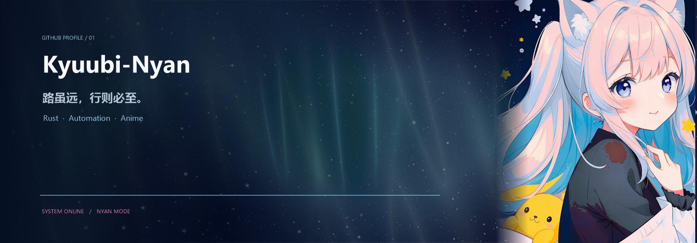

  

  

  
  
  
  

  

## 你好，我是 Kyuubi-Nyan

> 路虽远，行则必至。

喜欢折腾 **Rust、自动化工具**，也喜欢一切有点二次元的东西。  
偶尔写点实用的小工具，偶尔把界面做得比功能还认真一点。喵。

## GitHub 小档案

<table align="center">
  <tr>
    <td width="50%" align="center">
      <picture>
        <source media="(prefers-color-scheme: dark)" srcset="https://github-readme-stats.vercel.app/api?username=Kyuubi-Nyan&show_icons=true&hide_border=true&include_all_commits=true&rank_icon=github&bg_color=07111F&title_color=BFEAFF&icon_color=8EDBFF&text_color=E8F4FF&ring_color=A7C8FF&border_radius=18&cache_seconds=1800" />
        
      </picture>
    </td>
    <td width="50%" align="center">
      <picture>
        <source media="(prefers-color-scheme: dark)" srcset="https://github-readme-stats.vercel.app/api/top-langs/?username=Kyuubi-Nyan&layout=compact&langs_count=7&hide_border=true&bg_color=07111F&title_color=BFEAFF&text_color=E8F4FF&border_radius=18&cache_seconds=1800" />
        
      </picture>
    </td>
  </tr>
</table>

<table align="center">
  <tr>
    <td width="50%" align="center">
      <picture>
        <source media="(prefers-color-scheme: dark)" srcset="https://streak-stats.demolab.com/?user=Kyuubi-Nyan&hide_border=true&background=07111F&border=2B5F7F&stroke=BFEAFF&ring=8EDBFF&fire=FF8FC7&currStreakNum=E8F4FF&sideNums=E8F4FF&currStreakLabel=BFEAFF&sideLabels=8EDBFF&dates=91A9C4" />
        
      </picture>
    </td>
    <td width="50%" align="center">
      <picture>
        <source media="(prefers-color-scheme: dark)" srcset="https://github-profile-trophy-alpha.vercel.app/?username=Kyuubi-Nyan&theme=algolia&no-frame=true&no-bg=true&column=5&row=1&margin-w=8&margin-h=8&filter=multiLanguage,stars,repositories,experience,commits" />
        
      </picture>
    </td>
  </tr>
</table>

## 贡献轨迹

  <picture>
    <source media="(prefers-color-scheme: dark)" srcset="https://github-readme-activity-graph-blue.vercel.app/graph?username=Kyuubi-Nyan&bg_color=07111F&color=BFEAFF&line=8EDBFF&point=FF8FC7&area_color=162B42&area=true&hide_border=true&custom_title=Recent%20Activity" />
    
  </picture>

  <picture>
    <source media="(prefers-color-scheme: dark)" srcset="https://raw.githubusercontent.com/Kyuubi-Nyan/Kyuubi-Nyan/output/snake-dark.svg" />
    
  </picture>

  

  视觉素材来自 Pixabay，出处与许可见 <a href="./CREDITS.md">CREDITS.md</a>。保留热爱，偶尔摸鱼。

